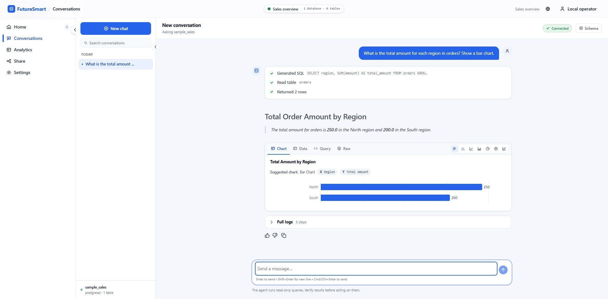

# FutureSmart Database Agent

**A working, opinionated AI Database Agent by [FutureSmart AI](https://futuresmart.ai/), released under Apache-2.0. A complete UI and backend reference application that shows how [AI Demos](https://aidemos.com/) research becomes product improvements.**

This is a working Database Agent that lets you connect a SQL database, ask questions in natural language, inspect generated SQL, explore results, and create visualizations.

**Research → product change: [S64 — unsupported data was reported as zero](docs/improvements/S64-unsupported-data.md).**
[Original published finding](https://aidemos.com/benchmarks/ai-database-agents/results/futuresmart-ai-database-agent/the-connected-data-cannot-answer-the-question): **Fail, unchanged** · Engineering correction: **released** · Independently accepted benchmark retest: **pending**.
This retrospective connects the finding to the code, regression controls and recorded validation; the correction predates this repository's public history.

But the purpose of this project goes beyond providing another text-to-SQL application.

## Why we're building this publicly

At [AI Demos](https://aidemos.com/), a research and benchmarking platform developed by FutureSmart AI, we evaluate AI products against real-world scenarios, capture evidence, and publish what works and what fails.

We wanted to demonstrate what happens when a product team actually uses those research findings to improve its own product.

So we're using FutureSmart Database Agent as a **public, ongoing case study**.

We take findings from AI Demos research, investigate reported failures, make engineering decisions, implement fixes, and document what actually changed.

You can follow that process here—from the original benchmark result to the implementation and subsequent verification.

**We're not trying to build another commercial Database Agent SaaS or achieve the highest benchmark score.** The objective is to maintain a complete, deployable, open-source reference implementation and demonstrate how systematic research can guide product development.

## From benchmark findings to product improvements

Our improvement history connects:

**Published benchmark result → Identified issue → Engineering investigation → Implementation → Verification**

And we publish the failures too.

For example:

- **Unsupported questions:** AI Demos identified a case where the agent returned zero using unrelated database information. We introduced explicit answerability checks and verified the behavior against missing, zero, and positive data cases.
- **Changing the question mid-conversation:** Research found cases where the agent changed the meaning of a metric during follow-ups. This remains an ongoing engineering investigation.
- **Excluded database tables:** A published test found that the agent accessed an excluded table despite refusing the request. We reproduced gaps with synthetic data, implemented fail-closed enforcement, and independently verified the source fix. It has not been deployed, and the original benchmark Fail is unchanged.

These are examples of actual findings, not claims that every issue has been resolved.

[Explore the published AI Demos benchmark results](https://aidemos.com/benchmarks/ai-database-agents/tools/futuresmart-ai-database-agent)

[Explore our engineering decisions and improvement history](docs/improvements/README.md)

## A complete reference application, not just a library

The repository includes the backend, web interface, database integrations, sample data, deployment configuration, and evaluation tools.

You can run the application, explore its architecture, reproduce supported test cases, and adapt the implementation to your own requirements.

We prioritize correctness, reliability, reproducibility, and a usable product experience over adding every feature found in commercial database-agent platforms.



One repository contains the FastAPI backend and Next.js UI. The supported stack
uses Docker Compose, PostgreSQL metadata, and Qdrant vectors. Source connections
support PostgreSQL and MySQL. Ordinary background tasks run in the API; the
included in-process report executor needs no separate worker service.

## Install

You need Git, Docker with Compose v2, and one `OPENAI_API_KEY`. The versioned
FutureSmart recommended profile assigns models automatically. Python 3.11 is optional; configuration can
run in a container.

```sh
git clone https://github.com/FutureSmart-AI/database-agent.git database-agent
cd database-agent
docker run --rm -v "${PWD}:/workspace" -w /workspace python:3.11-slim python deploy/configure.py
```

Set `OPENAI_API_KEY` in your shell before starting the API. Keep it private.
Compose forwards it at runtime; provider
keys are not frontend configuration or image build arguments.

```sh
docker compose build
docker compose up -d metadata-db sample-db qdrant
docker compose run --rm bootstrap
docker compose up -d api ui
```

Open **[localhost:3001/database-agent/](http://localhost:3001/database-agent/)**.
Sign in with `STANDALONE_LOGIN_PASSWORD` from the generated root `.env`.
No FutureSmart account is needed. Configuration generates independent secrets
and refuses to overwrite an existing file.

Recommended defaults: GPT-6.1 Sol for SQL and complex reasoning, GPT-6 Luna for
routing/descriptions/presentation, and text-embedding-3-small for new embeddings.
See [model configuration](docs/model-configuration.md) for single-provider chat
and per-operation overrides, endpoint requirements and existing-vector compatibility.

## Try the sample

Create an agent in the UI and choose PostgreSQL:

| Field | Value |
|---|---|
| Host / port | `sample-db` / `5432` |
| Database | `sample_sales` |
| Username | `sample_reader` |
| Password | `local-reader-only` |
| Description | Synthetic orders by region; amount is revenue in USD. |

Test the connection and finish the wizard. It discovers the `orders` table.
Ask:

> What is the total amount for each region in orders? Show a bar chart.

Check the SQL, rows, answer, and chart against **North: 250.00** and
**South: 200.00**. The sample has four orders and database-level read-only
grants. Use a dedicated read-only account for your own source databases.

## Stop and restart

```sh
docker compose down
docker compose up -d metadata-db sample-db qdrant api ui
```

Named volumes retain agents, conversations, sample data, and vectors. Keep
`.env`, especially `APP_MASTER_KEY` and `HASH_SALT`, with your backups:
changing them can make saved credentials unreadable. Avoid `down -v` unless
you intend to erase this installation's data.

## Guides and checks

- [Configuration and authentication](docs/configuration.md)
- [Direct product API and OpenAPI reference](docs/api.md)
- [AWS deployment: ECS/Fargate and static UI](docs/aws-deployment.md)
- [Development and reproducible evaluation](docs/development.md)
- [Architecture](docs/architecture.md) and [source layout](docs/source-layout.md)
- [Frontend development](frontend/README.md)

```sh
docker compose run --rm evaluate --fixture-only
docker compose run --rm evaluate
```

The first command checks sample results and read-only grants without a model
call. The second invokes real providers and verifies SQL, rows, and the answer.
Use the UI flow above to check the chart. Local ports bind to loopback; hosting
requires HTTPS, matching login origin, secure cookies, and private datastores.

## Known limits

Use read-only source credentials: the existing execution path is not a general
SQL sandbox. Review generated queries and results. Query-time descriptions do
not automatically include PostgreSQL table comments.

Flat and nested stacked-bar responses render through the same live and saved
conversation path. Stacked charts preserve individual series values, explicit
zeros and missing series. Invalid segmented data shows an explanation while
the supplied Data, Query and Raw views remain available.

Standalone login is for one operator. Broader hosted provider-key isolation,
shared website widget assets, and the retired external report-consumer lane
remain separate work. The in-process report option is included. Targeted
installation checks do not establish general benchmark accuracy or load capacity.

## License and provenance

Copyright 2026 FutureSmart AI. Released under the [Apache License 2.0](LICENSE).
The bundled fonts retain their original [SIL OFL notices](frontend/src/fonts/README.md);
see [NOTICE](NOTICE). This repository starts from a clean source snapshot rather
than importing private development history. Historical commit, PR and CI IDs in
our improvement records identify earlier work; they are not links to commits in
this fresh repository.

[Publication and compatibility notes](docs/publication.md) explain the retained
optional hosted URLs, source boundaries, and limited installation verification.
